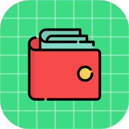

  

 

<table>
  <tr>
    <td align="center" width="180"><h3>2,500+</h3>people use Sessions</td>
    <td align="center" width="180"><h3>4.9 ★</h3>rating on Google Play</td>
    <td align="center" width="180"><h3>0</h3>ads, in any of my apps</td>
    <td align="center" width="180"><h3>9</h3>apps built from scratch</td>
  </tr>
</table>

## 👋 About me

I build Android apps with **Kotlin** and **Jetpack Compose**, and lately for iOS too with **Kotlin Multiplatform**. I care about craft: clean architecture, readable code, small details in the UI, and apps that hold up when real people use them every day.

My apps ship under **Yugen Tech**, my indie label. Two are live on Google Play and three more are on the way. They're free to start, never show ads, and keep your data private. Sessions grew to 2,500+ users across the US, France, Germany, Vietnam, the Philippines and more, entirely through Play Store search with no marketing spend.

Lately I've been going deep on **AI that's actually useful in an app**: on-device retrieval, grounded answers that don't make things up, and voice interfaces that feel natural.

- 🏢 **SDE at Amatyaa**, building a voice-driven CRM for real estate field agents with Kotlin Multiplatform and Compose Multiplatform.
- 🌱 Building **Hajime** (Japanese for Android and iOS) and **Mynt** (a voice money assistant).
- 💬 Happy to talk about Compose, Clean Architecture, RAG on mobile, or indie app building.

 

## 🚀 Live on Google Play

<table>
  <tr>
    <td width="50%" valign="top">
      
    </td>
    <td width="50%" valign="top">
      
    </td>
  </tr>
</table>

### &nbsp; Sessions: Pomodoro Focus Timer

A calm focus timer that's grown into my most loved app. It's free, has no ads, and is fully open source.

- **Three home layouts:** Classic, Refined and Studio, a watch-style dial with a floating dock, with a living colour glow that follows your session.
- **A timer you can trust:** a foreground service built to survive aggressive battery optimisation, with a live notification you can pause, skip or finish from.
- **Insights:** a year-in-pixels heatmap, streaks, your peak hours and where your time went, task by task.
- **Ambient sound** with adaptive ducking, **8 colour themes**, **6 fonts**, AMOLED black, and **10 languages** including right-to-left Arabic.
- **Your data, your call:** sign in to sync through Firebase, or use **guest mode**, where nothing leaves the phone, and carry it over later with a backup file.

**Stack:** Kotlin · Jetpack Compose · Material 3 · MVVM + Clean Architecture · Koin · Room · DataStore · WorkManager · Firebase Auth & Firestore · Play Billing

 

### &nbsp; Quill: AI Book Reader

An EPUB reader with **Aira**, an AI companion that has actually read your book. Ask about the plot, a character or a tricky passage, and Aira answers from the pages themselves, never from guesswork and **never spoiling what's ahead**.

- **Hybrid on-device RAG:** books are chunked and embedded on the phone with **BGE-small via ONNX Runtime**, then searched by meaning and by keyword (**FTS4**), merged with **Reciprocal Rank Fusion**.
- **Spoiler lock:** retrieval stops at your current chapter, so passages you haven't read never reach the model.
- **Ask from the page:** select a word, a name or a passage to define, explain, recall who a character is, or trace their whole journey so far.
- **Visualize scenes:** turn a passage into a painted illustration and jump back to it from a per-book gallery.
- **60,000+ free classics** from Project Gutenberg and Standard Ebooks, plus your own EPUBs, ambient sounds and reading insights.

**Stack:** Kotlin · Compose (Material 3 Expressive) · Multi-module Clean Architecture · Readium · ONNX Runtime · Room + FTS4 · Ktor · Koin · Firebase (Auth, Firestore, Cloud Functions in TypeScript) · Gemini · Google Cloud TTS · Play Billing

 

## 🛠️ Coming soon

<table>
  <tr>
    <td width="33%" valign="top" align="center">
      
      <h3>Hajime</h3>
      <b>Learn to read Japanese</b>
        
      
    </td>
    <td width="33%" valign="top" align="center">
      
      <h3>Mynt</h3>
      <b>Your voice money assistant</b>
        
      
    </td>
    <td width="33%" valign="top" align="center">
      
      <h3>Ryori</h3>
      <b>Cook something wonderful</b>
        
      
    </td>
  </tr>
  <tr>
    <td valign="top">

From your first kana to every JLPT kanji, **N5 to N1**, in small themed lessons. **Spaced repetition** brings each item back just before you'd forget it, and **Sensei**, an AI tutor, knows what you've studied, explains your mistakes and writes stories using only the kanji you can read. One Kotlin codebase runs on **Android and iOS**.

Compose Multiplatform · Room KMP · Ktor · Koin · Firebase · Cloud Functions · Gemini

</td>
    <td valign="top">

Just say what you spent: *"lunch was 250, a taxi home, and my salary came in"* becomes three neat entries. Mynt tracks **spending, budgets, debts and split bills**, answers questions like *"who still owes me?"*, and can talk back so you never have to look at the screen.

Compose · Multi-module Clean Architecture · Room · Firebase · Cloud Functions · Gemini · Soniox speech-to-text · Play Billing

</td>
    <td valign="top">

A calm recipe app for meals and mocktails from every kitchen in the world. It has a featured carousel, a cuisine of the day, a **Surprise me** button, step-by-step cooking with ingredients you tick off, a vegetarian switch, and recipes saved for **offline use**.

Compose · Ktor · Koin · Room · DataStore · Coil · Haze · TheMealDB & TheCocktailDB

</td>
  </tr>
</table>

 

## 🧰 Tech I work with

 

| Area | What I use |
|---|---|
| **Languages** | Kotlin · TypeScript |
| **UI** | Jetpack Compose · Compose Multiplatform · Material 3 · Material 3 Expressive · Lottie · Haze |
| **Architecture** | MVVM · Clean Architecture · Multi-module · Kotlin Multiplatform |
| **Data** | Room (incl. KMP & FTS4) · DataStore · WorkManager · Coroutines & Flow |
| **Networking & DI** | Ktor · Retrofit · Koin · Dagger Hilt |
| **Backend** | Firebase Auth · Firestore · Cloud Functions · Crashlytics · Analytics |
| **AI & voice** | Gemini · on-device RAG · ONNX Runtime · BGE embeddings · Google Cloud TTS · Soniox |
| **Shipping** | Google Play · Play Billing (subscriptions & in-app) · Baseline Profiles |

 

## 🌱 Where it started

The apps I built while learning the stack. Each one taught me something new, like API integration, local persistence or real-time sync.

<table>
  <tr>
    <td align="center" width="25%">
      <a href="https://github.com/MohammadAliUstad/Kaizen"> <b>Kaizen</b></a>
       Habit tracking & daily growth
       <code>Firebase</code> <code>Ktor</code> <code>Koin</code>
    </td>
    <td align="center" width="25%">
      <a href="https://github.com/MohammadAliUstad/Tenki"> <b>Tenki</b></a>
       Minimal weather & forecasts
       <code>Retrofit</code> <code>Hilt</code> <code>Moshi</code>
    </td>
    <td align="center" width="25%">
      <a href="https://github.com/MohammadAliUstad/Shuki"> <b>Shuki</b></a>
       Offline notes
       <code>Room</code> <code>MVVM</code>
    </td>
    <td align="center" width="25%">
      <a href="https://github.com/MohammadAliUstad/Keisan"> <b>Keisan</b></a>
       Everyday calculator
       <code>Compose</code> <code>MVVM</code>
    </td>
  </tr>
</table>

 

### How I build

**No ads, ever** &nbsp;·&nbsp; **Private by default** &nbsp;·&nbsp; **AI that's grounded, not guessing** &nbsp;·&nbsp; **Details matter**

 

Made with Kotlin, a lot of care, and probably a Pomodoro timer running in the background. 🍅

